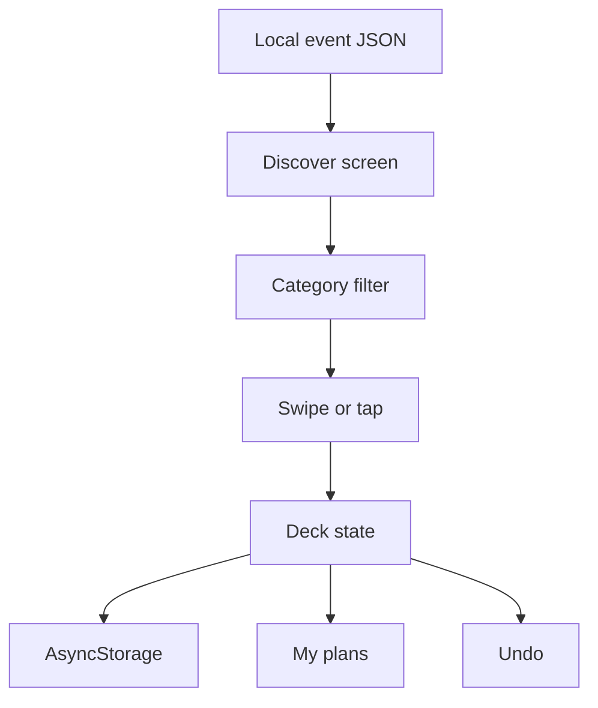

# CampusLoop

**A swipe-first campus event discovery app built with React Native + Expo.** Browse a curated campus event deck, filter it by category, swipe right to RSVP or left to pass, and keep your upcoming plans close.

## What it does

- **Swipe-to-RSVP:** swipe right to save an event and left to pass. The two large action buttons do the same thing for a tap-friendly demo.
- **Event directory:** eight editable sample events live in [`src/data/events.json`](src/data/events.json). Each event includes a title, category, date, location, host, description, availability, and poster palette.
- **Category filters:** Tech, Cultural, Sports, Workshop, Social, or All.
- **My plans:** upcoming RSVPs are sorted by date, show a live countdown, and can be removed.
- **Undo:** reverse the most recent swipe.
- **On-device persistence:** RSVPs, passes, and the latest undo action are stored locally with AsyncStorage. No sign-in or server is required.
- **Offline-first demo:** all event data is local; the app does not need a network connection after installation.

## How the app is structured



`App.js` owns the screens and gestures. `src/domain.js` contains the side-effect-free RSVP, skip, undo, filter, and date logic, so the most important behavior can be checked without a device. `AsyncStorage` persists the deck state on the device. The event directory stays in one JSON file, which makes it easy to swap in a campus API later.

The app deliberately skips sign-in and a backend because the task allows device-based storage. A right swipe records an RSVP, a left swipe records a pass, and the last action remains undoable across restarts. Both swipe directions also have visible buttons for keyboard-free, tap-based use and a more reliable live demo.

## Run it

Requirements: Node.js 22.13+ and npm. Install Expo Go on an Android phone, then from this folder run:

```bash
npm install
npx expo start
```

Scan the QR code from Expo Go. Keep the phone and development computer on the same network. Press `a` in the terminal to launch an Android emulator if one is configured.

## Build an Android APK

The preview profile is configured for an installable APK:

```bash
npm install
npx eas-cli login
npx eas-cli build --platform android --profile preview
```

EAS Build runs the Android toolchain in the cloud and provides an APK download when the build finishes. For a local development build, run `npx expo run:android` with Android Studio and an Android SDK installed.

## Verify the swipe and countdown logic

```bash
npm test
```

The unit tests cover RSVP/skip state, undo, category filtering, and countdown labels.

## Project map

```text
App.js                  Screens, swipe gestures, cards, and local persistence
src/data/events.json    Editable mock campus event directory
src/domain.js           Pure swipe, filter, date, and undo logic
test/domain.test.js     Logic tests using Node's built-in test runner
app.json                Expo and Android app configuration
eas.json                Internal APK build profile
```

## Demo notes

The event directory is sample data for a screening demo. Update `startsAt`, locations, clubs, and spots in `src/data/events.json` to match your campus. Dates and countdowns use the campus timezone (`Asia/Kolkata`). RSVP state is device-local and is intentionally not shared across users.
